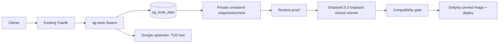

# Design: backup → shadow → Dokploy → readback
Краткая ops-spec, механизм соответствует одобренному владельцем плану 2026-11-13; продуктовый код не меняется.

## Компоненты, данные, интерфейсы
- Existing production: sidequests-agtools-a1xtnr; /root/.antigravity_tools contains accounts.json + indexed accounts/*.json, gui_config.json, SQLite DBs. Preserve account IDs and token/client-key hashes internally, emit booleans only. Orphan files must not become active accounts.
- Backup helper: existing host Python and bounded python Docker helper; copy non-DB files, sqlite3 backup API for each DB; retry if source JSON changes. Archive mode0600 in0700 folder. Restore into own scratch volume; independently validate all JSON and SQLite.
- Shadow: upstream docker.io/lbjlaq/antigravity-manager:v5.0.3@sha256:a10cc6e4580da081b84c86bdd715bd48e7867ad859d8adeecedf266203b70d51; linux/amd64 manifest sha256:ef3cdbf48b3de6dcefea838c7ba8120fe4009ad7990d813d77d74b3dc5e71133. Own cloned volume, restart=no, 127.0.0.1:18046→8045, no Traefik labels, capped memory/CPU; same auth settings, no automatic route exposure.
- GET /health returns status/version; GET / and JS assets exercise UI serving; GET /v1/models with Bearer uses data[].id; POST /v1/chat/completions consumes model/messages/max_tokens/stream, expects choices only if upstream access exists. Error body may be plain text; parse safely before classification.
- Dokploy applicationId sJtK_KfVh0AqvO_PIRo_Q: saveDockerProvider then deploy, verify stored dockerImage separately from docker service inspect/runtime health. Existing mount/env/networks must remain. No unrelated configuration updates.

## Поправка после shadow и review — 2026-11-13
Shadow сохранения данных прошёл, но реальные запросы502 upstream_network_error: новая версия строго сохраняет account_bindings→нерабочий proxy для предотвращения Direct IP leak. Старый v4.5.1 падал напрямую в Google403. Владелец явно разрешил отключить мёртвый пул и раскрывать Google IP сервера. Изменяем только proxy.proxy_pool.enabled=false сначала в остановленном shadow, проверяем ban вместо network error; затем при cutover в остановленном production. Список прокси и account_bindings сохраняем.
Review выявил, что online backup разных SQLite не гарантирует общей точки во времени. Поэтому перед cutover штатно scale ag-tools=0, дождаться остановки writer, выполнить новый cold backup+restore. Это окончательный rollback artifact. Если backup не проходит — scale1 на старом image и остановка rollout. Старый service spec сохраняется приватно; после Deploy сравниваем все env/mounts/networks.

## Migration/error/rollback
Upstream owns migration. Validate a restored shadow after two boots, key/account invariants and DB integrity. Old image ghcr.io/mint1524/ag-tools:sha-0066e12 remains locally available. Before cutover take fresh final archive if live data advanced. On readiness/auth/data regression, revert stored Dokploy image and redeploy old binary; if migrated data incompatible, stop only ag-tools and restore fresh archive first. Never overwrite active DB files under a running writer. Known upstream TOS ban is external and not hidden via fake quota/model mappings. Pending generation accepts no substituted vendor response.

## Verification and alternatives
FR1: health/catalog/Gemini/Sonnet + sanitized error, observed ban. FR2: archive hash/mode, full JSON/SQLite restore proof. FR3: inspect isolation and two starts, auth/catalog/assets, bounded model request. FR4: deployment/runtime + key/account/data invariant readback, compare service spec scope. FR5: external gate recorded; rerun only after owner account action. NFR: credentials only within remote memory/private backup, no Hermes edits or source compilation. Reject blind latest (mutable), restart-only (cannot lift ban), bringing dormant orphan accounts back, and transfer to another provider without permission.
