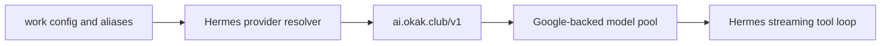

# Design — OKAK Hermes configuration repair

Micro-spec implementation of the approved 2026-10-28 plan; scope and restrictions in requirements.md.

## Components, data and interfaces
- Scope: root `/home/mint/.hermes` provider source and the ten existing synchronized profile configs with `providers.okak.base_url=https://ai.okak.club/v1` (11 total homes). Expanded by explicit owner clarification after the work-only fix was reverted by the shared-provider timer. Use `hermes --profile <name> config set/unset`, never hand-edit YAML; `default` explicitly targets the source.
- Repair root first, then clean only stale OKAK aliases in eligible profiles: the existing sync merges additions/updates but intentionally does not delete aliases. Do not change sync code/timer or run its broad sync manually. Verify persistence through a naturally scheduled timer run.
- Backup config and catalog cache privately outside git before mutation. Keep a sanitized manifest/evidence in this spec.
- Discover `GET /v1/models` with existing `OKAK_AI_API_KEY`; never print/store the key.
- Preserve aliases already naming retained exact IDs. Remove only `okak-*` entries routed to `okak` whose exact model ID is absent; create a new exact-ID alias for new catalog IDs, checking collisions. Do not touch aliases owned by another provider.
- Set `providers.okak.default_model`; add `providers.okak.api_mode=openai_chat` to make the raw picker discovery fingerprint match the existing transport and warm cache. This is an explicit declaration of the existing protocol, not a protocol change. Do not alter top-level `model`.
- Verify the shared production picker builder with normal cache-only opening: raw provider discovery uses `api_mode` rather than `transport`; absent api_mode caused a cache miss and a one-model row despite a complete cached catalog.
- Refresh only the OKAK model cache through shipped cache functions if a relevant entry exists; do not globally clear unrelated caches. Read back changed config and cache.

## Runtime and verification
Run real Hermes one-shots in a bounded fixture directory with a harmless local file tool and normal work provider/credential resolution. Limit toolsets and turns/budget; no production-side tool access. Use actual state.db session messages to verify tool name/result/final answer, not just CLI exit status. Prefer default production rules; `--ignore-rules` is an explicit diagnostic comparison only if needed, not the sole acceptance evidence.

No forced tool_choice, no disabling Claude thinking, no hidden fallback. An upstream failure stops acceptance and remains a blocker.

## Rollback
Retain the private backup path and hashes in evidence. Reverse only owned config keys with the supported config interface. Full backup restoration is allowed only after checking no concurrent/unrelated config edits occurred. Do not roll back unrelated changes.

## Alternatives rejected
- Production upgrade: unnecessary for the confirmed stale-default failure and separately gated.
- Aliasing 3.6/3.7 names to 3.8: conceals a model substitution.
- Changing the user's global model: violates scope.
